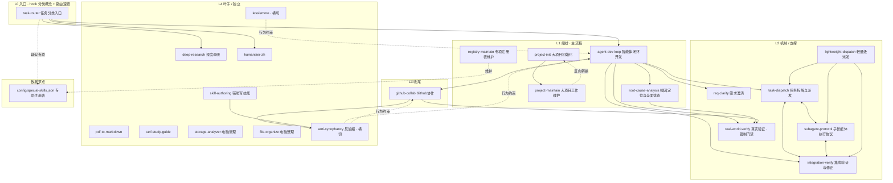

# MyWorkflow 技能连接拓扑

> 用途：维护参考 —— 技能间如何互相引用、添加/删除技能时应同步哪些连接。
> 最后核对：2026-08-04（v3.1.0，22 技能）
> 维护规则：改动任何技能引用后，**同步更新本文件的 Mermaid 图与边表**。

## 一、拓扑总览

- **形态**：有向无环图（DAG），22 个内部技能节点 + 1 个数据节点（专项注册表）。
- **分层**：L0 入口 → L1 编排 → L2 机制/支撑 → L3 收尾 → L4 叶子/横切。
- **特殊节点**：
  - `task-router` —— 极简分类速查（分类概念由 SessionStart hook 注入，本表仅快照）。
  - `real-world-verify` —— 汇聚门禁（chokepoint），编程路径必经，自身无出边。
  - `config/special-skills.json` —— 专项注册表数据节点：hook/维护 skill 写入，task-router 查询。

## 二、Mermaid 图

## 三、边表（维护查引用）

| 技能 | 出边（引用） | 入边（被引用） |
|------|-------------|---------------|
| `task-router` | agent-dev-loop, deep-research, humanizer-zh（Skill 调用）；→ special-skills.json（查询） | （无，会话入口） |
| `agent-dev-loop` | req-clarify, task-dispatch, integration-verify, real-world-verify, github-collab, root-cause-analysis | task-router |
| `root-cause-analysis` | real-world-verify（修复后验证） | agent-dev-loop |
| `registry-maintain` | → special-skills.json（维护） | （无，用户直接调） |
| `project-init` | project-maintain | （无） |
| `project-maintain` | project-init（反向转换） | project-init |
| `github-collab` | real-world-verify, anti-sycophancy | agent-dev-loop |
| `req-clarify` | （无） | agent-dev-loop |
| `task-dispatch` | subagent-protocol, integration-verify | agent-dev-loop, integration-verify, subagent-protocol, lightweight-dispatch |
| `subagent-protocol` | task-dispatch, integration-verify | task-dispatch, integration-verify, lightweight-dispatch |
| `integration-verify` | subagent-protocol, task-dispatch | agent-dev-loop, task-dispatch, subagent-protocol, lightweight-dispatch |
| `lightweight-dispatch` | task-dispatch, subagent-protocol, integration-verify | （无） |
| `real-world-verify` | （无） | agent-dev-loop, github-collab, root-cause-analysis |
| `anti-sycophancy` | （行为约束）agent-dev-loop, github-collab | github-collab, skill-authoring |
| `lessismore` | （行为约束）agent-dev-loop | （无，横切） |
| `skill-authoring` | anti-sycophancy | （无，用户直接调） |
| `deep-research` / `humanizer-zh` / `pdf-to-markdown` / `self-study-guide` / `storage-analyzer` / `file-organize` | （无） | task-router（前两个） |

> `→` = Skill() 调用或强文本引用；`-.->` = 数据/查询/行为约束关系。

## 四、结构特征

1. **编排铁三角（唯一强连通环）**：`task-dispatch ⇄ subagent-protocol ⇄ integration-verify` 两两互连，派发→执行→验证反馈回路。编辑三者任一时必须同步另两处。
2. **汇聚门禁**：`real-world-verify` 汇聚编程路径（agent-dev-loop / root-cause / github-collab），自身无出边。
3. **专项注册表数据节点**：hook（session-init.sh）触发扫描写入 `inventory`；`registry-maintain` 维护 `categories`；`task-router` 查询路由。三者围绕同一 JSON，改动需一致。
4. **hub 参考 + 门禁强制**：分类概念在 hook（~200 字锚点），速查表在 task-router，专项清单在注册表——分工清晰，无强制 hop。

## 五、维护指南

### 新增技能
1. 在对应层加 Mermaid 节点。
2. 需要被编排 → 在 agent-dev-loop / task-router 加引用，并加入 `plugin.json` skills 数组。
3. 属专项 → 运行 `hooks/registry-scan.sh` 刷新 inventory，再用 `registry-maintain` 归类到 categories。
4. 更新边表 + README 技能清单。

### 重命名 / 删除技能
1. 全局 `grep -rE "myworkflow:<旧slug>|「旧名」" skills/`，逐一替换。
2. 检查 task-router / agent-dev-loop 引用与 `plugin.json` skills 数组。
3. 删除后重扫注册表（inventory 自动移除），确认 categories 无死 slug。

### 结构红线
- `real-world-verify` 不可被绕过，也不可在它身上加出边（保持纯汇聚）。
- 铁三角互引是刻意冗余，删除任一条边前确认引用方没有依赖该语义。
- 注册表 inventory 只由 `registry-scan.sh` 写（保真），categories 只由 `registry-maintain` 写——两者不混改。
- 网文技能唯一归属 `webnovel-studio`，不要在 myworkflow 重新引入。

### ⚠️ 已知外部重叠
- `large-project-work` 插件仍提供与 `project-init` / `project-maintain` 同名的「大项目初始化/维护」技能（已双双注册进注册表「大项目」分类）。若描述过近导致注册被丢弃，需迁移或合并。
