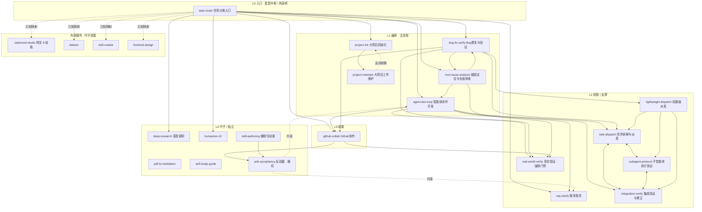

# MyWorkflow 技能连接拓扑

> 用途：维护参考 —— 技能间如何互相引用、添加/删除技能时应同步哪些连接。
> 最后核对：2026-08-04（v3.0.0，19 技能）
> 维护规则：改动任何技能引用后，**同步更新本文件的 Mermaid 图与边表**。

## 一、拓扑总览

- **形态**：有向无环图（DAG），19 节点、约 39 条内部有向边 + 4 条外部插件边。
- **分层**：L0 入口 → L1 编排 → L2 机制/支撑 → L3 收尾 → L4 叶子/横切。
- **两个特殊节点**：
  - `task-router` —— 星型中枢 + 唯一外部桥（v3 起为降级参考表，非强制 hop）。
  - `real-world-verify` —— 唯一汇聚门禁（chokepoint），四条编程路径必经，自身无出边。

## 二、Mermaid 图

## 三、边表（维护查引用）

| 技能 | 出边（引用） | 入边（被引用） |
|------|-------------|---------------|
| `task-router` | agent-dev-loop, bug-fix-verify, root-cause-analysis, github-collab, humanizer-zh, deep-research, project-init, req-clarify + 外部映射 | （无，会话入口直连） |
| `agent-dev-loop` | req-clarify, task-dispatch, real-world-verify, integration-verify, github-collab | task-router, bug-fix-verify(文本), root-cause-analysis, anti-sycophancy(文本) |
| `bug-fix-verify` | root-cause-analysis, lightweight-dispatch, task-dispatch, real-world-verify, github-collab, agent-dev-loop(文本) | task-router, root-cause-analysis |
| `root-cause-analysis` | agent-dev-loop, bug-fix-verify, real-world-verify | task-router, bug-fix-verify |
| `project-init` | project-maintain | task-router, project-maintain(反向) |
| `project-maintain` | project-init | project-init |
| `github-collab` | real-world-verify, anti-sycophancy | task-router, agent-dev-loop, bug-fix-verify |
| `req-clarify` | （无） | task-router, agent-dev-loop, anti-sycophancy(文本) |
| `task-dispatch` | subagent-protocol, integration-verify | agent-dev-loop, bug-fix-verify, integration-verify, subagent-protocol, lightweight-dispatch |
| `subagent-protocol` | task-dispatch, integration-verify | task-dispatch, integration-verify, lightweight-dispatch |
| `integration-verify` | subagent-protocol, task-dispatch | agent-dev-loop, task-dispatch, subagent-protocol, lightweight-dispatch |
| `lightweight-dispatch` | task-dispatch, subagent-protocol, integration-verify | bug-fix-verify |
| `real-world-verify` | （无） | agent-dev-loop, bug-fix-verify, root-cause-analysis, github-collab |
| `anti-sycophancy` | req-clarify, agent-dev-loop（文本） | github-collab, skill-authoring |
| `skill-authoring` | anti-sycophancy | （无，用户直接调） |
| `deep-research` / `humanizer-zh` / `pdf-to-markdown` / `self-study-guide` | （无） | task-router（其余无） |

> `→` = Skill() 调用或「」强引用；`→(文本)` = 仅文本提及，非工具调用。

## 四、三大结构特征

1. **编排铁三角（唯一强连通环）**：`task-dispatch ⇄ subagent-protocol ⇄ integration-verify` 两两互连，构成派发→执行→验证反馈回路。编辑三者任一时必须同步另两处。
2. **单一汇聚门禁**：`real-world-verify` 汇聚 4 条编程路径，自身无出边。它是全局质量咽喉——修改它影响所有链路的收尾。
3. **hub 参考 + 门禁强制**：v3 删除了 task-router 的强制 hop 边，把路由权交还 description 匹配；拓扑从"链式强制"变为"hub 参考 + 门禁强制"。

## 五、两条主数据流链

**功能开发链**（最长路径）：
`task-router → agent-dev-loop →(需求不清)→ req-clarify → task-dispatch → subagent-protocol → integration-verify → real-world-verify → github-collab`

**Bug 修复链**（带回溯）：
`task-router → bug-fix-verify →(深层)→ root-cause-analysis（只查不修，报告回流）→ lightweight-dispatch 并行修复 → real-world-verify → github-collab`

## 六、维护指南

### 新增技能
1. 在对应层加 Mermaid 节点。
2. 若要被编排者调用：在 `task-router` 的「已知映射」表（`skills/task-router/SKILL.md`）补一行，并视需要在 agent-dev-loop / bug-fix-verify 引用。
3. 更新边表 + README 技能清单。

### 重命名 / 删除技能
1. 全局 `grep -rE "myworkflow:<旧slug>|「旧名」" skills/`，逐一替换。
2. 检查 task-router 路由表与常见场景速查表。
3. 删除后确认无死链（本文件边表同步删）。

### 结构红线
- `real-world-verify` 不可被绕过，也不可在它身上加出边（保持纯汇聚）。
- 铁三角互引是刻意冗余，删除任一条边前确认引用方没有依赖该语义。
- 网文技能唯一归属 `webnovel-studio`，不要在 myworkflow 重新引入。

### ⚠️ 已知外部重叠
- `large-project-work` 插件仍提供与 `project-init` / `project-maintain` 同名的「大项目初始化/维护」技能（v3 只迁移了网文技能，未处理此重叠）。若两者描述过于接近导致注册被丢弃，需迁移或合并。
- `cc-reminder`、`large-project-work`、`webnovel-studio` 与本插件无引用边，仅经 `enabledPlugins` 共存。
